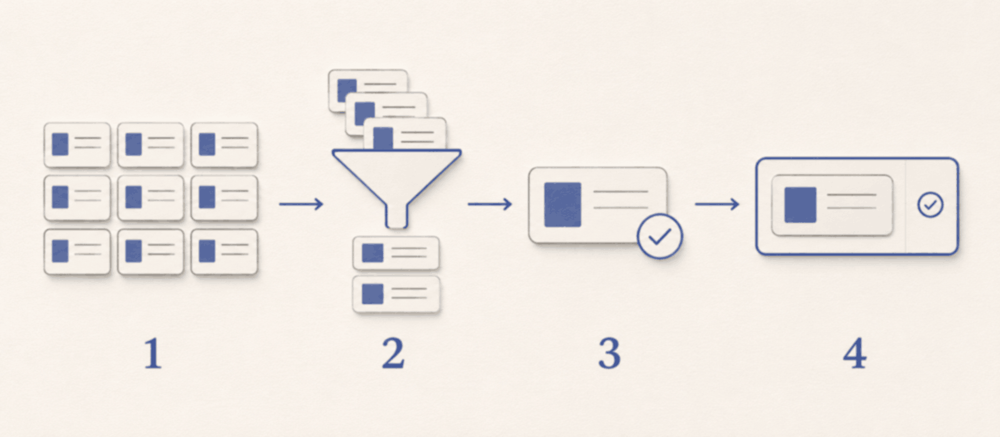

<picture>
  <source media="(prefers-color-scheme: dark)" srcset="docs/assets/readme-banner-dark.png">
  <source media="(prefers-color-scheme: light)" srcset="docs/assets/readme-banner-light.png">
  
</picture>

# Zotero 中文社区

帮助 Zotero 用户查找插件、核对版本适配、选择引用样式和学习日常用法的非官方中文社区。

**在线站点：[zoterocn.org](https://zoterocn.org)** · [中文教程](docs/README.md) · [收录规则](https://zoterocn.org/rules)

## 能做什么

| 需要解决的事 | 去哪里 |
|---|---|
| 找插件，比较用途与维护情况 | [插件广场](https://zoterocn.org/plugins) |
| 升级前确认作者声明的适配范围 | [Zotero 10 版本兼容页](https://zoterocn.org/compat/zotero-10) |
| 安装或切换引用样式 | [引用样式](https://zoterocn.org/styles) |
| 核对期刊收录、分区与影响因子 | [期刊查询](https://zoterocn.org/journals) |
| 学习安装、引用、同步与备份 | [本仓库教程目录](docs/README.md) |

目录持续更新，收录情况与更新日期以站点为准。人气只代表热度；收录不代表对插件安全性、稳定性或质量的背书。投稿前请到期刊官网和相应发布机构核对最新信息。

## 在 Zotero 中使用「Zotero中文社区」插件

插件把社区插件广场带进 Zotero，支持搜索、分类筛选、查看适配范围，以及在确认后安装或更新插件。目录内的插件遵守同一套规则，没有推荐位、付费置顶或按作者区别对待的安排；唯一例外是本社区自己维护的「Zotero中文社区」插件，它在插件广场顶部单独展示，不参与排序和计数，不接受其他插件申请这一位置。

安装步骤：

1. 到[插件 1.0.0 发布页](https://github.com/cnzotero/zotero-community/releases/tag/plugin-v1.0.0)下载 `zotero-community.xpi`（不要下载网页源码压缩包代替）。
2. 打开 Zotero「工具 → 插件」，按当前版本的提示从文件安装该安装包；如提示重启，请先完成重启。
3. 点文库工具栏里搜索框左侧的「插件市场」按钮打开插件市场，先核对适配范围与来源，再确认安装所需插件。

适用范围以[社区插件说明](plugin/README.md)与发布页为准。详细步骤见[插件市场教程](docs/plugins/community-plugin-market.md)。

<!-- 截图:社区插件市场浅色与深色窗口，使用公开示例，不含个人信息 -->
<!-- 截图:安装确认框，展示插件名、版本和来源 -->

## 开放目录数据

公开目录：[https://zoterocn.org/data/catalog.json](https://zoterocn.org/data/catalog.json)。目录只包含在架插件；部分插件可能没有可供一键安装的记录，仍可前往作者主页核对。

| 字段 | 含义 |
|---|---|
| `schema` | 数据格式版本，目前为 `1` |
| `generatedAt`、`site`、`count` | 整理日期、来源站点、当前目录条目数 |
| `categories` | 分类名称与对应标记 |
| `plugins` | 在架插件清单 |
| `id`、`name`、`summary`、`author`、`homepage` | 单个插件的仓库标识、名称、简介、作者与主页 |
| `category`、`zotero` | 分类，以及作者是否声明适配和声明的大版本范围 |
| `stars`、`updated`、`cadence` | 公开星标、更新时间与发布频率；部分信息可能缺少 |
| `dl`、`dlWeek`、`archived` | 累计下载、近七天新增下载、是否归档；无数据时不推算 |
| `releases` | 可获取的适配安装包；`t` 为 Zotero 大版本、`v` 为插件版本、`u` 为下载地址 |
| `releases` 中可选的 `i`、`min`、`max`、`d` | 插件标识、声明的最低与最高适配版本、发布日期 |

引用时请标注「来源：Zotero 中文社区（zoterocn.org），目录整理日期：以 `generatedAt` 为准」，并保留[第三方声明](THIRD_PARTY_NOTICES.md)。公开数字可能与作者主页暂有差异，最终请核对作者发布信息；目录不是安全认证。

## 收录与下架

收录面向 Zotero 7 及以上、源码可见、有真实用途和可获取安装包的插件。下架依据统一的发布时间、适配声明、安装包可用情况，以及经核实的安全、权利或作者申请等原因；作者发布新版本后会重新判断。

具体条件与处理口径以[完整收录规则](https://zoterocn.org/rules)为准，[下架记录](https://zoterocn.org/delisted)公开列出原因。功能相近或存在竞争关系不是拒绝收录的理由。

## 申请收录、更正与下架

- [申请收录](https://github.com/cnzotero/zotero-community/issues/new?template=request-listing.yml)：名称、仓库、适配版本、简要用途。
- [更正信息](https://github.com/cnzotero/zotero-community/issues/new?template=correct-info.yml)：具体条目、错误项目、正确信息与依据。
- [申请下架](https://github.com/cnzotero/zotero-community/issues/new?template=request-delisting.yml)：名称、与项目的关系、理由。
- [报告插件问题](https://github.com/cnzotero/zotero-community/issues/new?template=report-plugin-issue.yml)：先区分作者插件本身的问题与社区目录展示问题。

普通申请在 Issue 中公开回复。请勿提交私人文库、账号信息或未公开论文；安全问题先看[安全说明](SECURITY.md)。

## 参与贡献

欢迎纠错、补教程、完善无障碍说明和提供经过核对的资料。请先阅读[贡献指南](CONTRIBUTING.md)与[行为准则](CODE_OF_CONDUCT.md)，说明来源、核对日期和未实测的部分。教程初稿仍需结合真机截图复核。

## 许可证与第三方声明

`plugin/` 下社区插件代码采用 [MIT 许可证](plugin/LICENSE)。该授权不自动覆盖整个站点仓库，也不覆盖目录内其他作者的插件；各插件遵循各自许可证。目录初始名单、摘要及其他第三方素材的来源见[第三方声明](THIRD_PARTY_NOTICES.md)。如需复用站点其他内容，请先确认相应授权。

Zotero 是 Corporation for Digital Scholarship 的商标，本项目为社区自发运营的非官方项目，与 Zotero 官方无隶属关系。
