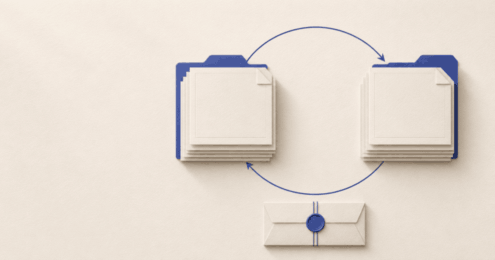

# 同步、备份与附件有什么区别

适用 Zotero 版本：桌面版 7 及以上；账号与附件服务的条件以官方说明为准。

最后核对于 2026-11-11。核对方式：官方同步与数据说明；以下设置和检查操作**未实测**。

## 你要解决什么

先分清三个结果：另一台电脑能看到题录，不代表已经能打开全部附件；两台电脑显示一致，也不代表能回到昨天误删之前。同步用于多设备保持资料一致，备份用于保留可回看的历史副本。不要等换电脑或发生误删时才第一次检查。[官方同步说明](https://www.zotero.org/support/sync)

## 操作步骤

### 1. 分别列出要保护的内容

写下自己需要的题录、笔记、标签、PDF 等附件，以及放在 Zotero 之外的文件。先用少量公开示例做清单，不凭窗口里出现一条文献就判断所有材料都在。若有只保存链接的附件，也单独记录它的保存方式；本文不把各种附件都当成已经复制进文库的文件。

<!-- 截图:演示题录、笔记与附件的分类清单 -->

### 2. 区分资料同步与附件同步

按照[官方说明](https://www.zotero.org/support/sync)核对当前账号的设置：题录等信息与附件文件属于不同部分，可以出现题录已同步、文件仍不可用的情况。不要反复删除条目试图触发下载；先看明确提示，检查另一台设备能否打开一份已知附件。涉及服务选择与限制时，以官方当前说明为准。

<!-- 截图:同步设置中资料与附件相关选项，账号已遮去 -->

### 3. 为历史副本安排独立备份

按[官方数据备份说明](https://www.zotero.org/support/zotero_data#backing_up_your_zotero_data)找到正在使用的数据目录，先关闭 Zotero，再保存完整副本到独立的备份位置；也可以采用能保留历史版本的系统备份工具。只导出一份参考文献清单不能完整代替文库备份。不要在程序仍打开时随意复制、移动或删除文库内容。

<!-- 截图:关闭 Zotero 后的备份记录，只显示示例名称 -->

### 4. 检查附件是否真的在副本中

结合当前附件下载方式核对本机保存情况：若附件按需下载，部分文件可能还没留在本机，做出的副本不一定含有它们。抽查几份已确认保存的公开附件，记录未包含的部分及其独立备份安排。不能只看副本文件夹有体积就宣布资料完整，也不要把链接失效当成题录消失。

<!-- 截图:演示附件清单与实际可打开情况 -->

### 5. 留下以后能用的恢复记录

记录备份日期、使用的 Zotero 版本、包含哪些内容，以及最后一次核对结果。把恢复方法与副本放在自己能找到的位置，但不要在公开反馈里暴露保存位置或文库内容。定期检查新资料是否纳入备份，发生问题时先保护现状，按[恢复准备教程](restore-library.md)判断下一步。

<!-- 截图:不含个人路径的备份核对记录 -->

## 常见问题

**同步成功就不怕误删吗？** 不是。删除等改动也可能同步到其他设备，所以仍需要历史副本。

**能用导出再导入当备份吗？** 官方不建议这样替代完整备份；重新导入可能改变资料关系，已有 Word 引用也可能受到影响。

## 相关教程

- [文库不见了，如何准备恢复](restore-library.md)
- [安装 Zotero 与第一个文库](../getting-started/install-zotero.md)
- [返回教程目录](../README.md)
